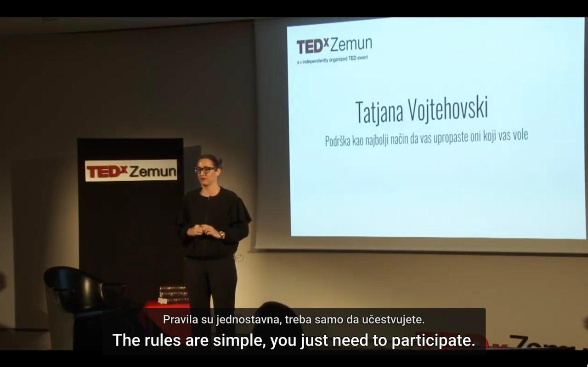
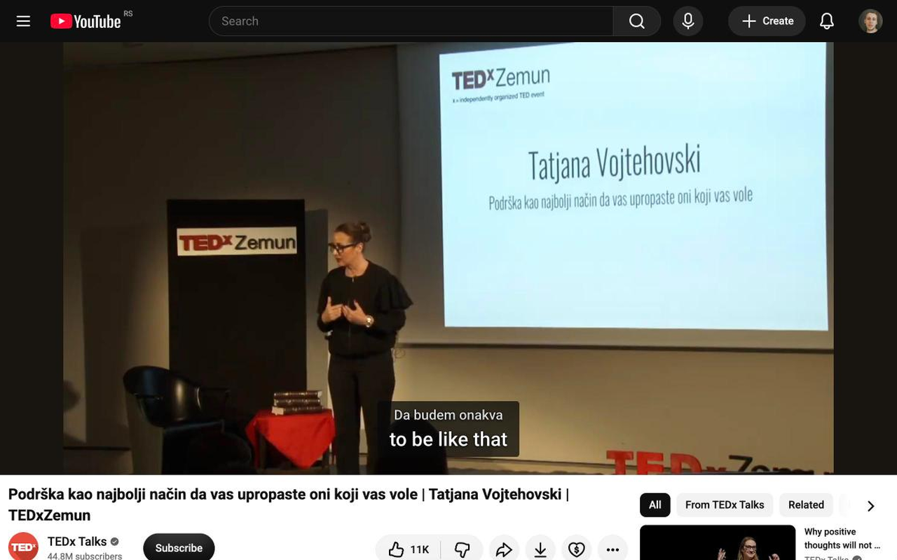
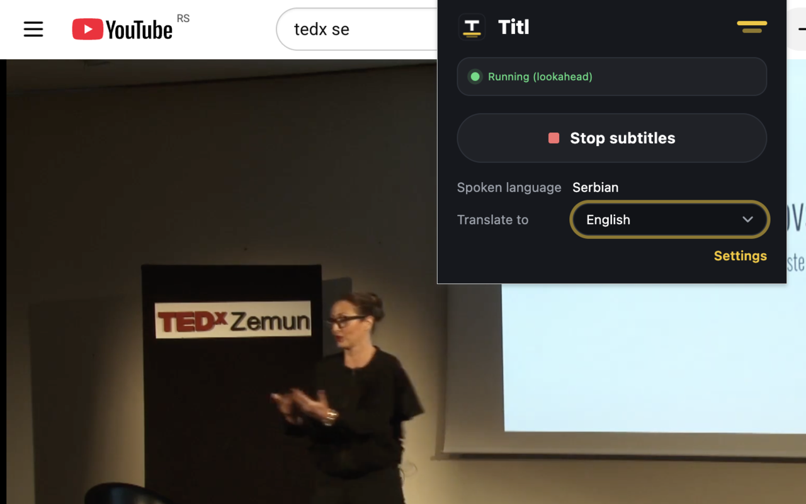
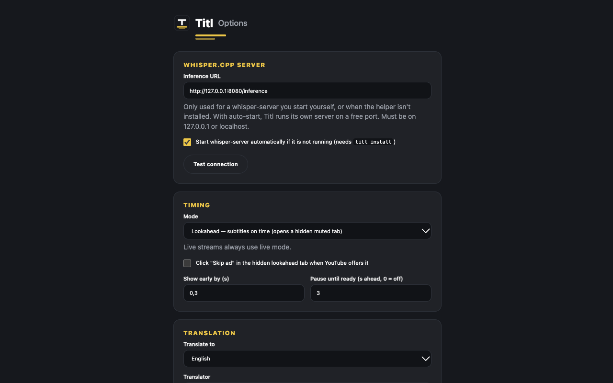

<div align="center">


# Titl

**On-time, private subtitles and translation for YouTube, transcribed on your own computer.**

[](https://chromewebstore.google.com/detail/titl/bpapgchpopccpbgbkfldmdmfmddgoeme)
[](https://github.com/rawmind/titl/releases/latest)
[](https://github.com/rawmind/titl/actions/workflows/ci.yml)
[](LICENSE)
[](https://ko-fi.com/rwmnd)

[**Add to Chrome**](https://chromewebstore.google.com/detail/titl/bpapgchpopccpbgbkfldmdmfmddgoeme) · [Install the helper](#install) · [Changelog](CHANGELOG.md) · [Privacy](PRIVACY.md) · [♥ Support](https://ko-fi.com/rwmnd)



</div>

## Why Titl

Most live-caption tools show each line **after** it's spoken, upload your audio to the cloud, or only work when YouTube already has captions. Titl runs [whisper.cpp](https://github.com/ggml-org/whisper.cpp) on **your** GPU, prepares subtitles **ahead** of what you're watching, and works on any video, even ones with no captions at all. It was built for Serbian and works with about 100 languages.

## Features

<table>
<tr>
<td width="50%" valign="top">

### ⏱️ On time, not late
- **Lookahead mode:** a muted copy of the video plays a few seconds ahead in a collapsed tab, so each line appears **with** the speech, or a moment before
- **Live mode** for live streams and any other tab: subtitles 3–5 s late
- Follows seeks, speed changes, ads and video changes, and pauses briefly until subtitles are ready

</td>
<td width="50%" valign="top">

### 🔒 Private by design
- Audio only goes to `127.0.0.1`, never to the cloud
- No accounts, analytics or tracking
- Signed releases, checksummed downloads, CI-built binaries ([Security](SECURITY.md))

</td>
</tr>
<tr>
<td valign="top">

### 🌍 Translation, built in
- **On-device** translation with Chrome's built-in translator into ~36 languages, ordered by popularity
- Or a **local LLM** (llama-server, Ollama, LM Studio) that reads the surrounding lines for context
- Original and translation shown together, or just the translation
- **Blur the translation** to practise listening: **V** (any keyboard layout) or a click reveals it

</td>
<td valign="top">

### 🎯 Accurate
- `large-v3-turbo` on Metal or CUDA (`small` on CPU)
- ~100 spoken languages, **detected automatically** or picked from a list with native names
- **Serbian:** always Latin or always Cyrillic, never a mix

</td>
</tr>
<tr>
<td valign="top">

### ⚙️ Zero-fuss setup
- One helper, `titl`, for macOS, Windows and Linux
- `titl install` finds or **downloads whisper.cpp** (CUDA or CPU) and a model, then registers with Chrome, Edge and Brave
- Starts the server on a **random free port** when you press Start
- Windows: install with **one PowerShell line**, or double-click the helper; it then **updates itself** from the popup

</td>
<td valign="top">

### 🎨 Feels native
- Subtitles in normal and fullscreen, never blocking YouTube's controls
- Dark popup and Options in Titl's colours
- **Save applies immediately** to running subtitles
- Interface in **12 languages**, chosen from your browser's language

</td>
</tr>
</table>

## Screenshots

| On YouTube | The popup | Options |
|---|---|---|
|  |  |  |

<sub>Video: [Tatjana Vojtehovski at TEDxZemun](https://www.youtube.com/watch?v=uu_h3BTFQjA). Subtitles are Titl's own output: Serbian (small, top) and Chrome's on-device English translation.</sub>

## Quick start

1. **[Add Titl to Chrome](https://chromewebstore.google.com/detail/titl/bpapgchpopccpbgbkfldmdmfmddgoeme)** (also works in Edge and Brave).
2. Install the helper:
   - **macOS:** `brew install rawmind/tap/titl && titl install`
   - **Windows:** in PowerShell, `irm https://github.com/rawmind/titl/releases/latest/download/install.ps1 | iex` (or download and double-click the helper, see [below](#windows))
   - **Linux:** download `titl` from the [latest release](https://github.com/rawmind/titl/releases/latest) and run `titl install` (details [below](#install))
3. Open a YouTube video, click **Titl → Start subtitles**.

## Requirements

- Chrome 116+, or Edge or Brave, on macOS, Windows or Linux (Chrome 138+ for Chrome's translator; any version for a local LLM)
- A GPU is recommended (Apple Silicon, or an NVIDIA card on Windows/Linux). CPU works with smaller models.
- About 0.5–1.6 GB of disk for the Whisper model, which the helper downloads

## Install

Titl has two parts: a small **helper** (`titl`) that runs [whisper.cpp](https://github.com/ggml-org/whisper.cpp) on your computer, and the **extension** in Chrome. Set up the helper for your system, then [install the extension](#install-the-extension) from the [Chrome Web Store](https://chromewebstore.google.com/detail/titl/bpapgchpopccpbgbkfldmdmfmddgoeme).

### macOS (Homebrew)

```bash
brew install rawmind/tap/titl   # also installs whisper.cpp
titl install
```

### Windows

In PowerShell:

```powershell
irm https://github.com/rawmind/titl/releases/latest/download/install.ps1 | iex
```

The script downloads `titl-windows-x64.exe` from the latest release, checks it against the release's `SHA256SUMS`, and runs `titl install`.

Or by hand: from the [latest release](https://github.com/rawmind/titl/releases/latest), download **`titl-windows-x64.exe`** and double-click it. Windows SmartScreen may warn about an unknown publisher (the file isn't code-signed): click **More info → Run anyway**. The window shows the setup and stays open until you press Enter. To pass options, run it from PowerShell instead: `.\titl-windows-x64.exe install --download-model small`.

**Updates:** once a day, when you open Titl's popup, the helper checks GitHub for a newer release. If there is one, the popup shows what it fixes and an **Update** button; the new helper is downloaded, checked against `SHA256SUMS` and used from the next Start. `titl update` does the same in a terminal. Helpers older than 0.1.15 can't update themselves: install 0.1.15 once with the PowerShell line above.

Either way, the helper downloads whisper.cpp (the CUDA build if you have an NVIDIA GPU, otherwise the CPU build) and a matching model, then registers with Chrome, Edge and Brave. It copies itself to `%LOCALAPPDATA%\chrome-transcriber\`, so you can delete the download afterwards.

### Linux (x64)

1. From the [latest release](https://github.com/rawmind/titl/releases/latest), download **`titl-linux-x64`** and make it executable: `chmod +x titl-linux-x64`.
2. Start Chrome once (so its profile folder exists), then:
   ```bash
   ./titl-linux-x64 install
   ```
   This downloads whisper.cpp's CPU build and a model, and registers with Chrome, Chromium, Edge and Brave. For GPU speed, [build whisper.cpp](https://github.com/ggml-org/whisper.cpp#quick-start) with CUDA or Vulkan and pass `--server /path/to/whisper-server`.

**Models:** with a GPU (Metal, CUDA) the default is `large-v3-turbo`, the most accurate. On CPU it's `small` (~470 MB), which keeps up with the video. Choose another with `--download-model NAME` (`base`, `small`, `medium`, `large-v3-turbo`, …). Lookahead mode gives transcription a head start, so a slower model still works, just with longer "Preparing subtitles…" pauses. Windows and Linux are tested in CI with the CPU builds; the CUDA build is not tested yet. If it doesn't run on your PC, `titl install` falls back to the CPU build by itself, and `--cpu` forces it.

### From source (any system)

Needs [Rust](https://rustup.rs) and a `whisper-server` (Homebrew, a whisper.cpp release, or your own build):

```bash
cargo build --release --manifest-path helper/Cargo.toml
helper/target/release/titl install
```

### What `titl install` does

- finds `whisper-server` (`--server PATH`, `PATH`, common whisper.cpp folders, or a copy it downloaded earlier);
- on Windows and Linux, if there is none, downloads a prebuilt whisper.cpp from [its releases](https://github.com/ggml-org/whisper.cpp/releases): it checks the file against GitHub's published SHA-256, test-runs it, and falls back to the previous build or the CPU build if it doesn't work. If GitHub can't be reached, it uses a known-good build pinned in the helper;
- finds a model, or downloads one (see Models above);
- copies itself to a per-user folder and registers with Chrome, Chromium, Edge and Brave (on Windows, through the registry);
- ends with the steps to load the extension, if it isn't loaded yet.

When you press **Start**, the helper launches whisper-server on a random free port above 10000 and tells the extension which one, so nothing clashes with other software. It keeps running until Chrome quits.

### Install the extension

Install **[Titl from the Chrome Web Store](https://chromewebstore.google.com/detail/titl/bpapgchpopccpbgbkfldmdmfmddgoeme)**. It also works in Edge and Brave, which install extensions from the Chrome Web Store.

#### Or load it unpacked

To run a development copy or the latest code, load the extension by hand instead:

1. Get the extension folder:
   - **macOS (Homebrew):** it's already installed at `$(brew --prefix)/opt/titl/share/titl/extension`. `titl install` copies this path to your clipboard.
   - **Windows / Linux:** from the [latest release](https://github.com/rawmind/titl/releases/latest), download **Source code (zip)** and unzip it.
   - **From source:** this repository's folder.
2. Open `chrome://extensions`, turn on **Developer mode** (top right), click **Load unpacked** and choose that folder.

Use the source code, not the `titl-x.y.z.zip` file attached to releases. That file is the Chrome Web Store package: loaded by hand, it gets a random ID and the helper refuses to talk to it. The source code's manifest fixes the ID at `fehpgpahkmanekioejihbpihpbacdjgb`, which the helper accepts, as well as the store version's ID.

### Helper commands

| Command | |
|---|---|
| `titl status` | Show the server, model, which browsers it's registered with, and whether the extension is loaded |
| `titl install …` | (Re)install; run again after moving whisper.cpp or a model |
| `titl install --update-server` | Download the newest prebuilt whisper.cpp (Windows, Linux) |
| `titl update` | Windows: download the newest helper, check it against the release's `SHA256SUMS`, and replace the installed copy |
| `titl uninstall [--purge]` | Unregister; `--purge` also deletes downloaded models |

Per-user files (config, downloaded models, `server.log`, and on Windows the daily update check in `update.json`) live in:
- macOS: `~/Library/Application Support/chrome-transcriber/`
- Linux: `~/.local/share/chrome-transcriber/`
- Windows: `%LOCALAPPDATA%\chrome-transcriber\`

## Usage

1. Open a YouTube video.
2. Click the extension icon, then **Start subtitles**.
3. In lookahead mode:
   - A muted tab opens next to yours for a moment (Chrome only plays media in a tab that has been shown). Then focus returns to your tab and the muted tab is tucked into a collapsed grey **Titl** tab group. Click the group to look at it, e.g. if it is stuck on an ad.
   - Your video pauses briefly while "Preparing subtitles…" is shown, about 12 s on first start, then plays with subtitles.
   - Press play at any time to skip the wait.
4. To finish, click **Stop subtitles**. The extension also stops by itself when you close either tab.

The first Start after launching Chrome waits about 4 s for the model to load. If you started `whisper-server` yourself, the extension uses it and never stops it.

## Settings

Open them from the popup's **Settings** link, or right-click the icon and choose **Options**.

| Setting | Default | Notes |
|---|---|---|
| Inference URL | `http://127.0.0.1:8080/inference` | Only for a whisper-server you start yourself, or if the helper isn't installed. With auto-start, Titl uses its own server on a free port. Must be `127.0.0.1` or `localhost`. **Test connection** checks it. |
| Start whisper-server automatically | on | Needs the helper from step 2 of Install. |
| Mode | Lookahead | Live streams always use live mode. |
| Show early by | 0.3 s | Lookahead: how far before its timestamp a line appears. |
| Pause until ready | 3 s | Lookahead: pause until this much is transcribed ahead. 0 never pauses. |
| Language | Detect automatically | Detect automatically, or any Whisper language code. |
| Serbian script | Latin | Latin, Cyrillic, or as returned (may mix). Only used when the language is Serbian, chosen or detected. |
| Translate to | Off | Target language. |
| Translator | Chrome's built-in | Chrome's on-device translator, or a local LLM through an OpenAI-compatible API. See [Translation](#translation). |
| Model API URL | `http://127.0.0.1:8081/v1` | Local LLM only. A server root, a `/v1` base or the full `/v1/chat/completions` URL. Must be on 127.0.0.1 or localhost. |
| Model name | empty | Local LLM only. Optional for llama-server; required by Ollama (`gemma3:12b`) and LM Studio. |
| Show the original above the translation | on | Two-line display: original small on top, translation below. |
| Blur the translation until you reveal it | off | The translation starts blurred; **V** or a click toggles it, and the choice carries over to the next lines. V isn't a YouTube shortcut and is ignored while typing. |
| Subtitle size | 100 % | Scales the subtitle text, 50–300 %. The size still follows the player's height. |
| Skip ads in the hidden tab | off | Lookahead: click YouTube's "Skip ad" in the muted tab when offered. Otherwise it waits the ad out. |
| Live window / step | 6 s / 4 s | Live mode chunking (2 s overlap). |
| Max window | 12 s | Largest chunk when transcription falls behind. |
| Lag warning threshold | 10 s | Live mode: show "delayed" past this. |

To pass extra flags to `whisper-server` (e.g. threads), add them to `"args"` in the helper's `config.json` (see `titl status`).

## Interface languages

Titl's popup, Options page and on-screen messages are available in English, Chinese, Hindi, Spanish, Arabic, French, Bengali, Portuguese, Russian, Indonesian, Ukrainian and Serbian. Chrome picks the language from your browser settings and falls back to English. Language names in the dropdowns also appear in your language. Translations live in [`_locales/`](_locales); corrections from native speakers are very welcome.

## Translation

Titl can translate with Chrome's built-in translator (the default) or with a language model running on your computer. Pick one in **Options → Translation → Translator**.

### Chrome's built-in translator

Choose **Options → Translate to**, then click **Download translation model** once. It downloads the language pack (one time, kept by Chrome) and shows a sample translation. If you skip this, the first click on the YouTube page during playback starts the download instead.

- Everything runs on this device through Chrome's [Translator API](https://developer.chrome.com/docs/ai/translator-api) (Chrome 138+).
- Chrome has no Serbian translation model, so Serbian is translated as Croatian. The text is always sent as Latin script, even when subtitles are shown in Cyrillic. Expect occasional word-choice slips where the two languages' vocabularies differ.
- In lookahead mode, translation happens seconds before a line is shown, so it adds no delay. In live mode it adds a fraction of a second.
- Whisper's own translation isn't used: `large-v3-turbo` was trained without translation data, and Whisper can only translate into English.

### Local LLM

A local model translates each line together with the 4 lines before it (and their translations) and, in lookahead mode, the 2 lines after it. That fixes most of what goes wrong when a sentence is split across lines or a word is misheard, keeps names and terms consistent, and translates Serbian as Serbian, not Croatian. It needs more memory than Chrome's translator, and you start the model server yourself.

1. Start an OpenAI-compatible server on this computer, for example [llama.cpp](https://github.com/ggml-org/llama.cpp) (`brew install llama.cpp`):

   ```sh
   llama-server -hf ggml-org/gemma-3-12b-it-GGUF --port 8081 --no-mmproj --swa-full -c 2048 -np 1
   ```

   The first start downloads the model. `--swa-full -c 2048 -np 1` matters: Titl's prompts stay under 300 tokens, and without `--swa-full` llama.cpp reprocesses Gemma's prompt on every line, which makes it about 3× slower. With `--swa-full` and Gemma's default 128k context, the cache doesn't fit in memory.
2. **Options → Translator → Local LLM**, check the **Model API URL**, and click **Test connection**. For Ollama use `http://127.0.0.1:11434/v1` and a model name such as `gemma3:12b`; for LM Studio, `http://127.0.0.1:1234/v1`.
3. **Save**.

Lines are translated one at a time, nearest to the playhead first. In lookahead mode, **Pause until ready** also waits for the translation, so lines don't show untranslated; set it to 0 to never pause. In live mode the translation appears a moment after the original.

#### Which model

Measured on 45 lines of a Serbian TEDx talk transcribed by `large-v3-turbo`, translated to English on an Apple M4 Max with the llama-server flags above, and in Chrome 157 for Chrome's translator. "Clearly wrong" is a manual count of lines whose meaning is lost or invented.

| Model | Download | Memory in use | Time per line (median / max) | Clearly wrong |
|---|---|---|---|---|
| [Gemma 3 12B](https://huggingface.co/ggml-org/gemma-3-12b-it-GGUF) (Q4_K_M) | 7.3 GB | 11.5 GB | 0.64 s / 0.82 s | ~3–4 of 45 |
| [Gemma 3 4B](https://huggingface.co/ggml-org/gemma-3-4b-it-GGUF) (Q4_K_M) | 2.5 GB | 4.9 GB | 0.20 s / 0.43 s | ~7 of 45 |
| [NLLB-200 distilled 600M](https://huggingface.co/facebook/nllb-200-distilled-600M) (int8, CTranslate2) | 0.6 GB | 1.5 GB | 0.27 s / 3.0 s | ~10 of 45 |
| Chrome's built-in translator (Serbian sent as Croatian) | one language pack, kept by Chrome | inside Chrome, not measured | 0.003 s / 0.03 s | ~8 of 45 |

- **Gemma 3 12B** is the one to use if you have 16 GB of memory or more. It gets split sentences and context right.
- **Gemma 3 4B** fits on smaller machines but makes more meaning errors in Serbian.
- **Chrome's built-in translator** is the default and by far the fastest, and needs no setup. It translates each line on its own and only knows Croatian, so it trips on lines cut mid-sentence ("I'm in order to find a tool…") and misheard words ("in Slavia").
- **NLLB** is small and fast, but it translates each line on its own, without context. llama.cpp can't run it, it needs a separate server, and its license (CC-BY-NC 4.0) allows non-commercial use only.

Memory in use is the server's resident memory: the model weights plus the cache. Gemma 3 4B was measured with `-c 8192`; `-c 2048` uses a little less.

## Languages

By default Titl detects the spoken language. Whisper guesses the language of each stretch of speech, and Titl uses the most frequent guess so far. Once one language has been detected 3 times, Titl keeps it for the rest of the video and stops asking. In lookahead mode it starts over on the next video. In live mode it keeps the language until you stop subtitles. The popup shows the detected language.

Detection can mix up close languages such as Serbian, Croatian and Bosnian, especially in the first seconds. If you know the language, pick it in **Options → Spoken language** (`en`, `ru`, `de`, `hr`, …), which is also slightly faster.

A few parts are tuned for Serbian:

- Script conversion only applies to Serbian, chosen or detected.
- The filter for phrases Whisper tends to invent (e.g. "Hvala na pažnji" over music) only lists Serbian phrases.
- In live mode, duplicate removal splits words on spaces, so it works poorly for Chinese or Japanese. Lookahead mode doesn't depend on it.

## Troubleshooting

| Symptom | Fix |
|---|---|
| Extension doesn't appear in Chrome after `install` | `install` doesn't add it: install it from the [Chrome Web Store](https://chromewebstore.google.com/detail/titl/bpapgchpopccpbgbkfldmdmfmddgoeme) ([Install the extension](#install-the-extension)). `titl status` shows whether Chrome has it. |
| "Auto-start helper stopped: Access to the specified native messaging host is forbidden" | You loaded the store package (`titl-x.y.z.zip`) by hand. Install it from the [Chrome Web Store](https://chromewebstore.google.com/detail/titl/bpapgchpopccpbgbkfldmdmfmddgoeme), or load the release's **Source code (zip)** instead. |
| Windows: "Windows protected your PC" | The helper isn't code-signed. Click **More info → Run anyway**, or install with the [PowerShell line](#windows), which doesn't show this warning. |
| Windows: Microsoft Defender blocks or removes `titl.exe` | A false positive on the unsigned helper. Restore it in **Windows Security → Protection history**, and report the file to Microsoft at [wdsi/filesubmission](https://www.microsoft.com/en-us/wdsi/filesubmission) ("Incorrectly detected"). |
| Popup: "Helper update failed: …" | The download or checksum check failed, and the installed helper was left as it was. Try again later, or run `titl update` in a terminal to see more. |
| "The Titl helper isn't installed on this computer" | Click **Download it** in the popup, or run `titl install`, then try again. |
| "whisper-server exited…" or "did not start" | Check `server.log` in the helper's folder. Run `titl status`: a path marked "(missing!)" means re-run `install`. |
| "Cannot reach whisper-server" | The server URL or port is wrong, or auto-start is off. Use **Test connection** in Options. |
| Stuck on "Preparing subtitles…" | Expand the **Titl** tab group and look at the hidden tab: it may be showing an ad, a consent page or a sign-in prompt. Fix it there, or switch to live mode. |
| Subtitles appear in the wrong script | Options → Serbian script. |
| Translation doesn't appear | The language pack may not be downloaded yet. Use **Download translation model** in Options, or click the YouTube page once while subtitles are on. |
| "Click the video once to download the translation model" | Click anywhere on the YouTube page, or use **Download translation model** in Options. |
| "Translation unavailable: Cannot reach the model API" | The local model server isn't running, or the **Model API URL** is wrong. Use **Test connection** in Options. |
| "Model API returned 403" with Ollama | Start Ollama with `OLLAMA_ORIGINS='chrome-extension://*'` so it accepts requests from the extension. |
| Local LLM translation pauses the video often | The model is slower than the speech. Start llama-server with `--swa-full -c 2048 -np 1`, or pick a smaller model. |
| "Chrome can't translate … on this device" | That language pair isn't offered by Chrome's translator. Pick another target. |
| Nothing happens after moving the extension folder | Remove and re-load the unpacked extension. |

To remove the helper, run `titl uninstall`.

## How it works

### Lookahead mode

```
your tab ── main-state (time, paused, rate) ──▶ background ◀── scout-state / scout-audio ── hidden muted tab
   ▲                                                │                                         (same video, ahead)
   └──────── cues on the video timeline ────────────┘── POST /inference (verbose_json)
```

- The hidden tab's audio comes from `video.captureStream()` and is stamped with video time.
- Audio is cut into 8 s windows that don't overlap. Each window starts where the last *complete* Whisper segment ended. A segment within 1 s of the window edge may be cut mid-word, so it is redone in the next window.
- Segment timestamps place each cue at an exact video time. Your tab shows the cue at `currentTime + showEarlySec`.
- The hidden tab follows seeks, video changes and playback rate. It pauses once it is 45 s ahead and, if enabled in Options, clicks "Skip ad".
- Cost: the video streams twice.

### Live mode

```
popup → background (tabCapture stream id) → offscreen document
  getUserMedia(tab) ─┬─ AudioContext → speakers (tab keeps playing)
                     └─ AudioContext @16 kHz → AudioWorklet → ring buffer
  every step: WAV window (16 kHz mono s16) → POST /inference → dedup → overlay
```

- Windows overlap by 2 s. Text deduplication (longest suffix/prefix token match, ignoring case, punctuation, diacritics and script) removes the repeated words.
- One request runs at a time and audio sits in a fixed-size buffer. When transcription falls behind, the next window grows instead of requests queuing up, so memory stays bounded.

### Auto-start helper

Chrome extensions can't run native programs, so `titl` (Rust, in `helper/`) is registered as a Chrome [native messaging](https://developer.chrome.com/docs/extensions/develop/concepts/native-messaging) host. On Start, the extension asks it to launch `whisper-server`. The server stops when that connection closes, which in practice means when Chrome quits. On Windows the popup also asks it, once a day, whether a newer helper is out ([Updates](#windows)).

## Development

```bash
npm test                                         # extension; no dependencies, Node 20+
cargo test --manifest-path helper/Cargo.toml     # helper
npm run package                                  # Chrome Web Store zip in dist/ (manifest key removed)
python3 scripts/locales.py                       # regenerate _locales/ after editing the translations
```

After editing, reload the extension in `chrome://extensions`. If you changed `content.js`, also reload the YouTube tab.

## Support Titl

Titl is free and open source, with no ads or paid features. If it helps you, you can buy me a coffee on **[Ko-fi](https://ko-fi.com/rwmnd)**. It keeps the project going. Bug reports, ideas and pull requests help just as much.

[](https://ko-fi.com/rwmnd)

## Changelog

See [CHANGELOG.md](CHANGELOG.md) and [Releases](https://github.com/rawmind/titl/releases).

## Privacy

Nothing leaves your computer. See [PRIVACY.md](PRIVACY.md).

## Security

To report a vulnerability, see [SECURITY.md](SECURITY.md). Please don't use public issues.

## License

MIT, see [LICENSE](LICENSE). Bundling whisper.cpp or a Whisper model (both MIT) means including their license notices.
